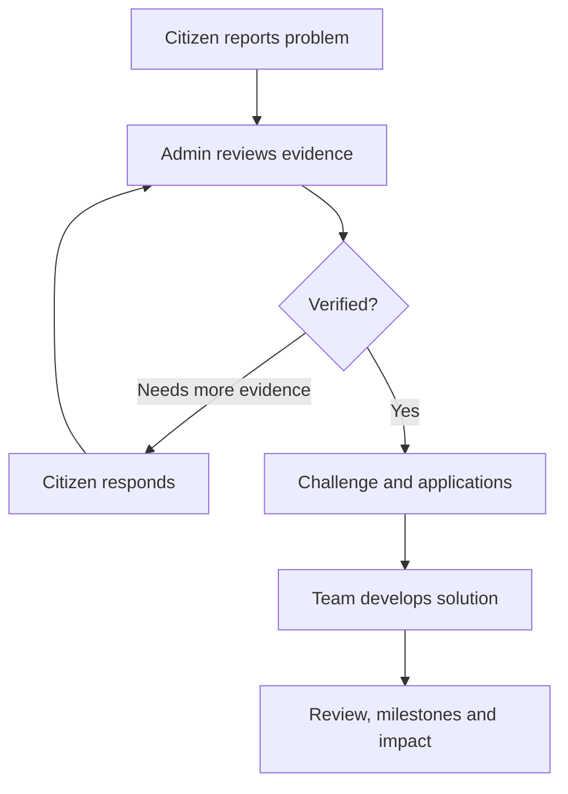
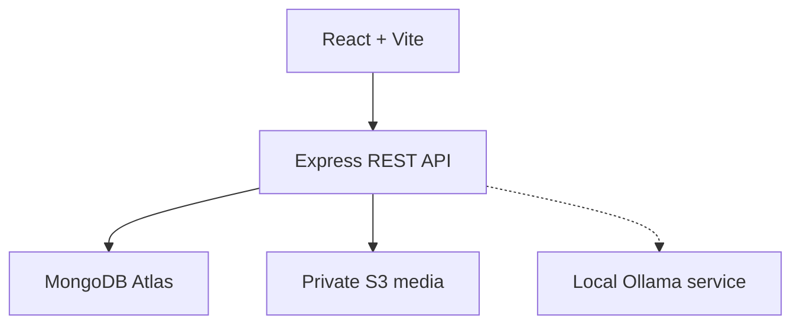
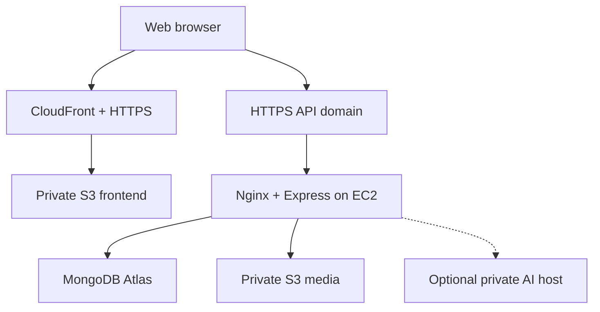

# Societal Platform

**Report local problems. Organize community challenges. Build and track solutions.**

Societal Platform is a full-stack civic collaboration application that connects citizens who report community problems with administrators who verify them and students or teams who propose solutions. The platform supports evidence-based reporting, challenge applications, teamwork, solution reviews, implementation milestones, and impact tracking.

The project is built with **React, TypeScript, Node.js, Express, MongoDB, and AWS S3**. It also includes an optional, locally hosted AI assistant powered by **Ollama** to help citizens improve problem descriptions.

> **Project status (19 November 2026):** v1 development and local production hardening are substantially complete. The latest reported verification passed **364 backend tests across 29 suites**, and both production builds passed. **AWS deployment and live production/staging verification are still pending.** These figures are from the latest project readiness report, not a newly executed test run.

## Contents

- [Why Societal Platform?](#why-societal-platform)
- [Main features](#main-features)
- [How the platform works](#how-the-platform-works)
- [User roles](#user-roles)
- [Technology stack](#technology-stack)
- [Architecture](#architecture)
- [Repository structure](#repository-structure)
- [Getting started](#getting-started)
- [Environment configuration](#environment-configuration)
- [Local AI with Ollama](#local-ai-with-ollama)
- [API overview](#api-overview)
- [Testing and quality checks](#testing-and-quality-checks)
- [Security considerations](#security-considerations)
- [AWS deployment plan](#aws-deployment-plan)
- [Current status and known limitations](#current-status-and-known-limitations)
- [Project roadmap](#project-roadmap)

## Why Societal Platform?

Community problems such as damaged roads, broken streetlights, drainage failures, and waste-management issues can be difficult to document, prioritize, and follow through to resolution.

Societal Platform creates a structured workflow:

1. A citizen reports a problem with its location, category, priority, description, and supporting images.
2. An administrator reviews the report, requests additional evidence when necessary, and verifies or rejects it.
3. An administrator connects a verified problem to a challenge.
4. Eligible participants apply, form teams, and propose solutions.
5. Solutions go through review, implementation tracking, and impact recording.

The goal is to help turn **a reported issue into a documented, collaborative response**, rather than leaving it as an isolated complaint.

## Main features

### 1. Authentication and role-based access

- Account registration and login with password hashing.
- JWT-based authenticated API access.
- Role-based route permissions and resource-level ownership checks.
- Account-state checks against the database for authenticated requests.
- Frontend protected routes and session handling.

### 2. Civic problem reporting

- Create reports with a title, detailed description, priority, and location.
- Select from hierarchical categories, including infrastructure, water, health, education, environment, transportation, sanitation, and other issues.
- Choose a location through the map/location input.
- Attach supporting images through private S3 upload flows.
- View reports and their evidence after submission.
- Review status and priority changes through problem history.

**Problem lifecycle:** `REPORTED` → `UNDER_REVIEW` → `VERIFIED` or `REJECTED` (with supported review/reopening transitions).

### 3. Admin review and evidence requests

- Review and prioritize incoming reports.
- Request additional photographs or other supporting media.
- Allow the original reporter to respond to pending evidence requests.
- Track evidence-request state and administrative actions.
- Restrict sensitive review actions to authorized users.

### 4. Dynamic categories

- MongoDB-backed categories with parent–child relationships.
- Category activation, selection eligibility, and display ordering.
- Initial dataset of **26 categories**: 8 root categories and 18 subcategories.
- Validation that checks category availability and hierarchy.

### 5. Challenges and applications

- Create challenges associated with community problems.
- Browse challenges and inspect their details.
- Submit student applications and review application status.
- Enforce relevant application, deadline, and role rules.

### 6. Teams and invitations

- Create teams associated with challenges.
- Track team membership and access to team resources.
- Support team invitations and invitation responses.
- Apply membership and eligibility checks before sensitive actions.

### 7. Solutions, implementation, and impact

- Submit solutions for challenges through eligible teams.
- Review solutions and record review decisions.
- Track implementation state (for example, `PLANNING`, `IN_PROGRESS`, and `COMPLETED`).
- Add and update milestones.
- Record impact metrics and attach authorized evidence.

### 8. Optional local AI writing assistant

- Improve a draft problem title and description using a model served by Ollama.
- Return structured suggestions that the user can review before applying.
- Keep the original draft available when AI is offline or times out.
- Disable the AI action in production when no private model service is configured.

## How the platform works



### Example scenario

A resident notices several streetlights are not working near a community park:

1. They create a **Streetlights** problem report and upload a photograph.
2. An administrator reviews the report and requests a clearer image.
3. The resident submits the requested evidence.
4. The administrator verifies the report and creates a **Smart Streetlight Monitoring** challenge.
5. A student applies, joins a team, and submits a monitoring-and-repair proposal.
6. After review, the team tracks implementation milestones and records measurable outcomes.

## User roles

The authentication model defines these roles:

| Role | Typical purpose |
| --- | --- |
| `USER` | Report problems and respond to evidence requests. |
| `STUDENT` | Explore challenges, apply, participate in teams, and contribute solutions. |
| `ADMIN` | Review problems, manage challenge/application workflows, and review solutions. |
| `UNIVERSITY` | Defined account role; permissions depend on the relevant route. |
| `MENTOR` | Defined account role; permissions depend on the relevant route. |
| `ORGANIZATION` | Defined account role; permissions depend on the relevant route. |

Not every role has an independent v1 dashboard or complete specialized workflow. Backend authorization and resource ownership determine access; the table is **not** a blanket grant of permissions.

## Technology stack

| Layer | Technologies |
| --- | --- |
| Frontend | React, Vite, TypeScript, Tailwind-based/custom UI |
| Backend | Node.js, Express, TypeScript |
| Database | MongoDB Atlas, Mongoose |
| Validation | Zod |
| Authentication | JSON Web Tokens (JWT), bcrypt |
| Media | Amazon S3, AWS SDK for JavaScript v3, presigned URLs |
| Local AI | Ollama, `llama3.1:8b` (configurable) |
| Backend testing | Jest, Supertest, TypeScript test tooling |
| Planned AWS hosting | EC2, Nginx, S3, CloudFront, optionally Route 53 and AWS-managed monitoring/secrets |

## Architecture

### Local development



- The React frontend calls the Express API using `VITE_API_URL`.
- The backend applies authentication, validation, business rules, and authorization.
- MongoDB stores application data and relationships.
- S3 stores uploaded media; the backend controls the creation of upload/download URLs.
- Ollama is contacted **server-to-server**. The browser does not communicate directly with Ollama.

### Planned production architecture



> AWS hosting is **planned, not yet completed**. The initial deployment retains MongoDB Atlas; it does not require migrating to Amazon DocumentDB. If production Ollama is unavailable, AI remains disabled while the core reporting workflow continues operating.

## Repository structure

```text
societal-platform/
├── server/
│   ├── src/
│   │   ├── config/           # Environment and database setup
│   │   ├── controllers/      # HTTP request handlers
│   │   ├── middleware/       # Authentication, authorization, validation
│   │   ├── models/           # Mongoose schemas
│   │   ├── routes/           # API route definitions
│   │   ├── seeders/          # Category seeding
│   │   ├── services/         # Business rules and AI provider
│   │   ├── validators/       # Zod schemas
│   │   ├── app.ts            # Express application
│   │   └── server.ts         # HTTP server entry point
│   ├── __tests__/            # API and integration-style route tests
│   ├── .env.example          # Safe backend configuration template
│   └── package.json
├── web/
│   ├── src/
│   │   ├── components/       # UI building blocks, maps, evidence
│   │   ├── context/          # Authentication state
│   │   ├── layouts/          # Shared layouts/navigation
│   │   ├── pages/            # Application screens
│   │   ├── routes/           # Frontend routing and access guards
│   │   ├── services/         # API client and session utilities
│   │   └── types/            # TypeScript API/domain types
│   ├── tests/                # Frontend security/config tests
│   ├── .env.example          # Safe frontend configuration template
│   └── package.json
├── deploy/
│   └── aws/                  # Nginx, systemd, S3/IAM and SPA templates
└── docs/
    ├── api/                 # API behavior documentation
    ├── AWS_DEPLOYMENT_GUIDE.md
    ├── JWT_SECURITY_AUDIT.md
    └── PRODUCTION_READINESS.md
```

Additional tests are colocated beside relevant backend modules. This tree summarizes the principal folders rather than every file.

## Getting started

### Prerequisites

- Node.js and npm compatible with the repository's package requirements.
- A MongoDB Atlas database with suitable network access.
- An AWS S3 bucket and credentials/identity with the required limited permissions for media workflows.
- **Optional:** Ollama with a compatible installed model.

Do not use production credentials or production data for development or destructive testing.

### 1. Clone the repository

```bash
git clone https://github.com/gauravsharma712006-lgtm/societal-platform.git
cd societal-platform
```

### 2. Install backend dependencies

```bash
cd server
npm ci
```

Copy `server/.env.example` to `server/.env` and fill in your own values. Never commit `.env`.

### 3. Install frontend dependencies

Open another terminal from the repository root:

```bash
cd web
npm ci
```

Copy `web/.env.example` to `web/.env.local`, then configure `VITE_API_URL` if your backend is not at the development default.

### 4. Start the backend

From `server/`:

```bash
npm run dev
```

The development API normally runs at `http://localhost:5000`. Confirm availability:

```text
GET http://localhost:5000/api/health
```

### 5. Start the frontend

From `web/`:

```bash
npm run dev
```

Open the URL printed by Vite (typically `http://localhost:5173`).

### 6. Category data

The project includes an idempotent category seeder, previously used to create 26 initial categories. **Only run it against a database you have explicitly verified is safe to modify.**

```bash
# Run from server/ only after checking the connected database
npx tsx src/seeders/category.seed.ts
```

Do not run seeding commands blindly against an existing production environment.

## Environment configuration

Use the committed example files as the authoritative templates:

- `server/.env.example`
- `web/.env.example`

### Backend variables

| Variable | Purpose |
| --- | --- |
| `NODE_ENV` | `development`, `test`, or `production`. |
| `PORT` | Express HTTP port (development default: `5000`). |
| `HOST` | Bind address; production is intended to use loopback behind Nginx. |
| `TRUST_PROXY` | Trusted proxy configuration for reverse-proxy deployments. |
| `MONGODB_URI` | MongoDB connection URI. **Secret.** |
| `JWT_SECRET` | Strong random token-signing secret. **Secret.** |
| `JWT_ISSUER` | JWT issuer expected by the API. |
| `JWT_AUDIENCE` | JWT audience expected by the API. |
| `JWT_ACCESS_TOKEN_TTL_SECONDS` | Token lifetime; current production maximum is 8 hours. |
| `CORS_ORIGIN` | Explicit allowed browser origin(s), comma-separated. |
| `AWS_REGION` | S3 bucket AWS Region. |
| `AWS_S3_BUCKET_NAME` | Private media bucket. |
| `AWS_ACCESS_KEY_ID` / `AWS_SECRET_ACCESS_KEY` | Optional paired static AWS credentials; prefer an EC2 IAM role in production. **Secrets.** |
| `AWS_SESSION_TOKEN` | Optional temporary credential token. **Secret.** |
| `AI_ENABLED` | Enable/disable server-side AI support. |
| `OLLAMA_BASE_URL` | Base URL of a reachable private Ollama instance. |
| `OLLAMA_MODEL` | Installed model identifier, e.g. `llama3.1:8b`. |

### Frontend variables

| Variable | Purpose |
| --- | --- |
| `VITE_API_URL` | Full public API base URL, including `/api`. |
| `VITE_AI_ENABLED` | Whether the UI offers AI assistance. |

Local frontend example:

```dotenv
VITE_API_URL=http://localhost:5000/api
VITE_AI_ENABLED=true
```

Production frontend example (**replace the sample domain**):

```dotenv
VITE_API_URL=https://api.example.com/api
VITE_AI_ENABLED=false
```

In production, the backend requires explicitly allowed HTTPS origins and appropriate JWT configuration. **Vite embeds `VITE_*` values into the public frontend build**, so never put secrets in these variables.

## Local AI with Ollama

The AI capability is an **optional enhancement**, not a dependency of basic Problem reporting.

### Run a local model

Install Ollama using its official installation instructions, then verify which models are available:

```bash
ollama list
```

If `llama3.1:8b` is already installed, test it:

```bash
ollama run llama3.1:8b "Improve this civic report title: Broken streetlight near the park"
```

Verify the local service:

```text
http://127.0.0.1:11434/api/tags
```

Use these backend settings for local development:

```dotenv
AI_ENABLED=true
OLLAMA_BASE_URL=http://127.0.0.1:11434
OLLAMA_MODEL=llama3.1:8b
```

Then open the **Problems** page, enter a draft, and select **Improve with AI**. Review the generated suggestion before applying it.

**Important production distinction:** `127.0.0.1` on a deployed backend means the backend host, **not the developer's laptop**. Do not expose the Ollama port publicly. For an AI-disabled initial deployment, set both `AI_ENABLED=false` and `VITE_AI_ENABLED=false`. Hosting Ollama privately on AWS is a future deployment decision and has not been provisioned.

## API overview

The HTTP API uses the `/api` prefix. The routes below are representative; refer to `server/src/routes/` and `docs/api/` for complete definitions, input validation, and role requirements.

| Method | Endpoint | Purpose |
| --- | --- | --- |
| `GET` | `/api/health` | Process liveness. |
| `GET` | `/api/ready` | Application/database readiness. |
| `POST` | `/api/auth/register` | Register an account. |
| `POST` | `/api/auth/login` | Authenticate and receive a token. |
| `GET` | `/api/problems` | List problems visible to the requester. |
| `POST` | `/api/problems` | Create a civic problem report. |
| `POST` | `/api/problems/:problemId/media` | Associate authorized uploaded media with a report. |
| `PATCH` | `/api/problems/:problemId/status` | Admin review/status transition. |
| `PATCH` | `/api/problems/:problemId/priority` | Admin priority update. |
| `GET` | `/api/problems/:problemId/history` | Review visible problem history. |
| `POST` | `/api/problems/:problemId/evidence-requests` | Admin requests further evidence. |
| `POST` | `/api/problems/:problemId/evidence-requests/:requestId/respond` | Reporter responds with evidence. |
| `POST` | `/api/ai/improve-problem` | Suggest improvements to a draft when AI is enabled. |

Other route groups cover `/api/categories`, `/api/challenges`, `/api/applications`, `/api/teams`, `/api/team-invitations`, `/api/solutions`, `/api/media`, and `/api/users`.

### Authenticated requests

The existing browser/API integration uses bearer tokens:

```http
Authorization: Bearer <your-jwt-token>
```

The API applies the appropriate route permissions and resource checks. A valid JWT does **not** mean the account can access all resources.

## Testing and quality checks

### Backend

From `server/`:

```bash
npm run build
npm test -- --runInBand
```

To run an individual suite:

```bash
npm test -- --runInBand __tests__/problem.routes.test.ts
```

### Frontend

From `web/`:

```bash
npm run build
```

The most recent production-readiness report also ran targeted frontend security/configuration tests using the installed `tsx` runtime:

```bash
# Run from the repository root
node server/node_modules/tsx/dist/cli.mjs --test web/tests/production-security.test.ts
```

### Verification record

As reported by the November 19, 2026 readiness review:

| Check | Last reported result |
| --- | --- |
| Backend Jest | **364 tests passed**, 29 suites, zero failures. |
| Backend TypeScript build | Passed. |
| Frontend production build | Passed. |
| Focused frontend config/security tests | Passed (9 tests). |
| Basic unauthenticated browser smoke | Passed locally. |
| Production dependency vulnerability audit | **Not completed** (registry unavailable). |
| AWS deployment and live cloud verification | **Not yet performed**. |

Automated mocks do not establish behavior against actual Atlas, AWS IAM, S3, or public HTTPS endpoints. Before release, run a controlled end-to-end staging journey with disposable users and data.

## Security considerations

The project includes production-hardening measures such as:

- JWT verification with an explicit signing algorithm, issuer/audience, age/expiration checks, and current user-role validation.
- A strong production signing-secret requirement and limited token lifetime.
- Password hashing and registration validation, including bcrypt byte-length handling.
- Login/registration throttling and safer authentication error responses.
- Role and ownership checks on protected operations.
- Zod request validation and bounded request bodies.
- Helmet and an explicit production CORS origin allowlist.
- Private S3 access through scoped, expiring signed URLs.
- Controlled AI timeouts and graceful fallback when a local model is unavailable.

**Known limitations under review before public traffic:**

- The current frontend retains bearer tokens in `localStorage`; preventing cross-site scripting remains important.
- Access tokens have limited revocation capabilities until they expire.
- The current login/register limiter is process-local; multiple API instances need shared/perimeter enforcement.
- Concurrent team creation requires further live verification of uniqueness rules.
- S3 object signature/type checks do not constitute antivirus scanning.
- A previous test IAM identity could upload/read S3 objects but could not delete them; cleanup needs an explicit retention policy and authorization.
- Production dependency advisories still require a successful audit.

See [`docs/JWT_SECURITY_AUDIT.md`](docs/JWT_SECURITY_AUDIT.md) and [`docs/PRODUCTION_READINESS.md`](docs/PRODUCTION_READINESS.md) for the complete security and release audit.

### Responsible secret handling

- Never commit `.env`, AWS keys, MongoDB connection strings, private keys, or production JWT secrets.
- Use the `.env.example` files only as templates.
- Prefer an EC2 IAM instance role instead of embedding long-lived AWS credentials.
- Apply least-privilege S3 IAM policies and private bucket access.
- Keep backend ports and databases off the public internet wherever possible.
- Configure billing alerts and verify resource costs before creating AWS infrastructure.

## AWS deployment plan

The initial release is designed around:

1. **EC2** running the compiled Express API under `systemd` behind Nginx and HTTPS.
2. **MongoDB Atlas** for application data, with restricted network connectivity.
3. **Private S3 media storage** with least-privilege access and correctly configured signed uploads/downloads.
4. **S3 + CloudFront** for the compiled React single-page application, with private origin access and HTTPS.
5. **Environment/configuration management** for production secrets, JWT claims, API origins, and logs.
6. **Optional future Ollama hosting** on a private AI machine; not required for the first release.

The repository includes example deployment configuration under [`deploy/aws/`](deploy/aws/) and a procedural guide at [`docs/AWS_DEPLOYMENT_GUIDE.md`](docs/AWS_DEPLOYMENT_GUIDE.md).

### Deployment checklist

- [ ] Confirm an AWS account, Region, budget, and billing alerts.
- [ ] Review the exact Git commit that will be deployed; ensure no secrets or generated artifacts were staged.
- [ ] Complete dependency vulnerability audits and review findings.
- [ ] Configure a production database and restricted Atlas network access.
- [ ] Configure EC2, IAM instance role, security groups, TLS, Nginx, and systemd.
- [ ] Configure the private media bucket, IAM policy, CORS, and upload/read tests.
- [ ] Configure HTTPS API DNS, `CORS_ORIGIN`, JWT issuer/audience, and protected secrets.
- [ ] Build the frontend with its **real** `VITE_API_URL` and intentional AI flags.
- [ ] Deploy the frontend using a private S3 origin and CloudFront, including SPA route handling.
- [ ] Validate health/readiness checks, monitoring, and rollback instructions.
- [ ] Complete authenticated, multi-role staging tests with disposable data.
- [ ] Verify authorization boundaries, uploads, mobile layout, and session expiration.
- [ ] Approve public release only after staging gates pass.

Do not deploy with `https://api.example.com/api` or `https://api.example.invalid/api`: those are placeholders. Do not use the disposable integration database as a production database.

## Current status and known limitations

**Completed or implemented for v1**

- Core full-stack application modules and primary citizen → admin → challenge → student → team → solution workflow.
- Dynamic categories and category seeding.
- Private media workflows and evidence requests.
- Local Ollama integration with offline error handling.
- Production configuration and JWT hardening.
- AWS deployment templates and documentation.

**Still pending**

- Publishing and configuring live AWS infrastructure.
- Production dependency security audit.
- Controlled live staging verification against actual Atlas/S3 and the deployed host.
- Final review of remaining auth/session, scaling, and concurrent-team-creation limitations.
- Team invitation flow with a second disposable student account (previous manual test deferred).

## Project roadmap

| Milestone | Status |
| --- | --- |
| **1 — Core application and API** | Completed. |
| **2 — Core integration workflow** | Manually verified; a few edge cases remain deferred. |
| **3 — Production hardening and deployment preparation** | Local work completed; cloud prerequisites pending. |
| **4 — AWS staging, deployment, and release** | Pending. |

Future enhancements, such as analytics, notifications, expanded administrative tools, or dedicated cloud AI hosting, are **outside the v1 release scope**.

---

**Maintainer:** [Gaurav Sharma](https://github.com/gauravsharma712006-lgtm)  
**Repository:** [github.com/gauravsharma712006-lgtm/societal-platform](https://github.com/gauravsharma712006-lgtm/societal-platform)

> Societal Platform is a software project and demonstration workflow, not an official government complaint portal or a guarantee of real-world issue resolution.
