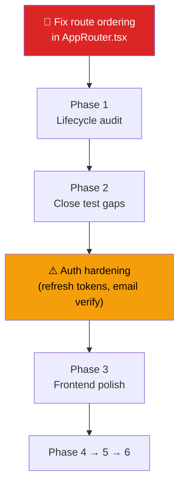

# 🔍 Societal Platform — Project Review

## At a Glance

| Dimension | Assessment |
|---|---|
| **Overall progress** | ~55–60% of a production-ready V1 |
| **Architecture quality** | ✅ Clean, well-layered (controller → service → model) |
| **Data modelling** | ✅ Rich, thoughtful schemas with audit trails |
| **Auth & authZ** | ⚠️ Functional but missing production-critical hardening |
| **Test coverage** | ⚠️ Good foundation (185 tests), gaps in teams/invitations |
| **Frontend** | ⚠️ 19 pages built, but several are placeholders |
| **Production readiness** | 🔴 Not yet — see Phase 6 concerns below |

---

## 1. What's Actually Built — Verified from Code

### Backend (Express / TypeScript / MongoDB)

| Layer | Files | Notes |
|---|---|---|
| **Models** | 8 ([user](file:///d:/Coding/Be-Better/G1/societal-platform/server/src/models/user.model.ts), [problem](file:///d:/Coding/Be-Better/G1/societal-platform/server/src/models/problem.model.ts), [challenge](file:///d:/Coding/Be-Better/G1/societal-platform/server/src/models/challenge.model.ts), [application](file:///d:/Coding/Be-Better/G1/societal-platform/server/src/models/application.model.ts), [team](file:///d:/Coding/Be-Better/G1/societal-platform/server/src/models/team.model.ts), [team-member](file:///d:/Coding/Be-Better/G1/societal-platform/server/src/models/team-member.model.ts), [team-invitation](file:///d:/Coding/Be-Better/G1/societal-platform/server/src/models/team-invitation.model.ts), [solution](file:///d:/Coding/Be-Better/G1/societal-platform/server/src/models/solution.model.ts)) | Solution model is impressively detailed — milestones, impact indicators, evidence, full history |
| **Controllers** | 9 + 1 test file | Solution controller is the largest (~15KB) reflecting the workflow depth |
| **Services** | 8 (+ 4 test files) | Clean service layer with proper ownership/membership checks |
| **Routes** | 9 modules | All mounted on `/api/*` with auth + role guards |
| **Validators** | 15 Zod schemas | Comprehensive input validation |
| **Middleware** | [authenticate](file:///d:/Coding/Be-Better/G1/societal-platform/server/src/middleware/auth.middleware.ts), [authorize](file:///d:/Coding/Be-Better/G1/societal-platform/server/src/middleware/authorize.middleware.ts), [validate](file:///d:/Coding/Be-Better/G1/societal-platform/server/src/middleware/validate.middleware.ts) | JWT + RBAC + Zod validation middleware |

### Frontend (React / Vite / TailwindCSS v4)

| Area | Pages | Status |
|---|---|---|
| **Auth** | [Login](file:///d:/Coding/Be-Better/G1/societal-platform/web/src/pages/Login.tsx), [Signup](file:///d:/Coding/Be-Better/G1/societal-platform/web/src/pages/Signup.tsx) | ✅ Working |
| **Core workflow** | [Problems](file:///d:/Coding/Be-Better/G1/societal-platform/web/src/pages/Problems.tsx), [Challenges](file:///d:/Coding/Be-Better/G1/societal-platform/web/src/pages/Challenges.tsx), [ChallengeDetails](file:///d:/Coding/Be-Better/G1/societal-platform/web/src/pages/ChallengeDetails.tsx), [Solutions](file:///d:/Coding/Be-Better/G1/societal-platform/web/src/pages/Solutions.tsx), [SolutionDetails](file:///d:/Coding/Be-Better/G1/societal-platform/web/src/pages/SolutionDetails.tsx) | ✅ Substantial (Solutions detail page is 53KB!) |
| **Teams** | [Teams](file:///d:/Coding/Be-Better/G1/societal-platform/web/src/pages/Teams.tsx), [TeamDetails](file:///d:/Coding/Be-Better/G1/societal-platform/web/src/pages/TeamDetails.tsx), [Invitations](file:///d:/Coding/Be-Better/G1/societal-platform/web/src/pages/Invitations.tsx) | ✅ Working |
| **Admin** | [AdminApplications](file:///d:/Coding/Be-Better/G1/societal-platform/web/src/pages/AdminApplications.tsx), [SolutionReviews](file:///d:/Coding/Be-Better/G1/societal-platform/web/src/pages/SolutionReviews.tsx), [Verification](file:///d:/Coding/Be-Better/G1/societal-platform/web/src/pages/Verification.tsx) | ✅ Reviews done, Verification at 21KB but may be partial |
| **Placeholder** | [Reports](file:///d:/Coding/Be-Better/G1/societal-platform/web/src/pages/Reports.tsx) (~815B), [Analytics](file:///d:/Coding/Be-Better/G1/societal-platform/web/src/pages/Analytics.tsx) (~810B) | 🔴 Shell pages, not wired |
| **Unused** | [Register.tsx](file:///d:/Coding/Be-Better/G1/societal-platform/web/src/pages/Register.tsx) | ⚠️ Orphaned — router uses Signup.tsx |

### Tests

| Test file | Location |
|---|---|
| Route integration | [problem.routes.test.ts](file:///d:/Coding/Be-Better/G1/societal-platform/server/__tests__/problem.routes.test.ts), [challenge.routes.test.ts](file:///d:/Coding/Be-Better/G1/societal-platform/server/__tests__/challenge.routes.test.ts), [application.routes.test.ts](file:///d:/Coding/Be-Better/G1/societal-platform/server/__tests__/application.routes.test.ts) |
| Service unit | [solution.service.test.ts](file:///d:/Coding/Be-Better/G1/societal-platform/server/src/services/solution.service.test.ts) (52KB!), [challenge.service.test.ts](file:///d:/Coding/Be-Better/G1/societal-platform/server/src/services/challenge.service.test.ts), [application.service.test.ts](file:///d:/Coding/Be-Better/G1/societal-platform/server/src/services/application.service.test.ts), [team.service.test.ts](file:///d:/Coding/Be-Better/G1/societal-platform/server/src/services/team.service.test.ts), [team-invitation.service.test.ts](file:///d:/Coding/Be-Better/G1/societal-platform/server/src/services/team-invitation.service.test.ts) |
| Controller unit | [solution.controller.test.ts](file:///d:/Coding/Be-Better/G1/societal-platform/server/src/controllers/solution.controller.test.ts) |
| Middleware | [validate.middleware.test.ts](file:///d:/Coding/Be-Better/G1/societal-platform/server/src/middleware/__tests__/validate.middleware.test.ts) |

> [!NOTE]
> Team and invitation service tests **do exist** (8KB and 11KB respectively), contrary to the earlier note that coverage was "missing". They may just need expansion for edge cases.

---

## 2. Specific Issues Found in the Code

### 🔴 Critical

| # | Issue | File | Detail |
|---|---|---|---|
| 1 | **Routes defined after the `*` catch-all** | [AppRouter.tsx:218–256](file:///d:/Coding/Be-Better/G1/societal-platform/web/src/routes/AppRouter.tsx#L206-L256) | `/challenges/:challengeId`, `/invitations`, and `/teams/:teamId` are declared **after** `path="*"` → they'll never match in React Router v7. These routes need to move above the `*` catch-all. |
| 2 | **No refresh token / no logout** | [auth.middleware.ts](file:///d:/Coding/Be-Better/G1/societal-platform/server/src/middleware/auth.middleware.ts) | Single long-lived JWT with no server-side revocation. A stolen token is valid until expiry. |
| 3 | **`isVerified` never set to `true`** | [user.model.ts:59-62](file:///d:/Coding/Be-Better/G1/societal-platform/server/src/models/user.model.ts#L59-L62) | The field exists but there's no email verification flow; anyone can act immediately after registration. |

### ⚠️ Important

| # | Issue | File | Detail |
|---|---|---|---|
| 4 | **No `2dsphere` index on problem coordinates** | [problem.model.ts](file:///d:/Coding/Be-Better/G1/societal-platform/server/src/models/problem.model.ts) | GeoJSON coordinates are stored but geo-queries (`$near`, `$geoWithin`) won't work without the index. |
| 5 | **Solution `createSolutionEvidenceUpload` doesn't check `reviewStatus`** | [solution.service.ts:485-540](file:///d:/Coding/Be-Better/G1/societal-platform/server/src/services/solution.service.ts#L485-L540) | Evidence upload is blocked only by `implementationStatus === 'COMPLETED'`, not by review status — a team could upload evidence to a rejected solution. |
| 6 | **Global error handler leaks in dev** | [app.ts:83-85](file:///d:/Coding/Be-Better/G1/societal-platform/server/src/app.ts#L83-L85) | `err.message` exposed when `NODE_ENV === 'development'`. Fine for now, but ensure it's stripped before production. |
| 7 | **`web/src/store/` is empty** | — | No global state management (no Redux/Zustand/Context beyond auth). As the app grows, prop-drilling will become painful. |
| 8 | **Orphaned `Register.tsx`** | [Register.tsx](file:///d:/Coding/Be-Better/G1/societal-platform/web/src/pages/Register.tsx) | 2.2KB file imported nowhere — router uses `Signup.tsx`. Should be deleted. |

### 💡 Minor / Stylistic

| # | Issue | Detail |
|---|---|---|
| 9 | Problem model history interface has a formatting issue | Multi-field single line at [problem.model.ts:41-47](file:///d:/Coding/Be-Better/G1/societal-platform/server/src/models/problem.model.ts#L41-L47) — noted in your own ROADMAP.md |
| 10 | `CORS_ORIGIN` defaults to `*` | [app.ts:29](file:///d:/Coding/Be-Better/G1/societal-platform/server/src/app.ts#L29) — fine for dev, must be locked down for prod |
| 11 | Only 3 reusable components | [EvidenceModal](file:///d:/Coding/Be-Better/G1/societal-platform/web/src/components/EvidenceModal.tsx), [LocationPicker](file:///d:/Coding/Be-Better/G1/societal-platform/web/src/components/LocationPicker.tsx), [ProblemLocationMap](file:///d:/Coding/Be-Better/G1/societal-platform/web/src/components/ProblemLocationMap.tsx). Large pages (33KB Problems, 53KB SolutionDetails) likely have duplicate UI patterns that could be extracted. |

---

## 3. Roadmap Feedback

Your 6-phase roadmap is well-structured and correctly sequenced. Here are my observations:

### Phase 1 — Lifecycle & Permissions Audit ✅ Correct priority

> [!IMPORTANT]
> **Fix the `AppRouter.tsx` catch-all ordering first.** Routes below `path="*"` are silently broken. This is a 2-minute fix that should happen before any other Phase 1 work.

The ownership/membership checks in your service layer look solid (e.g., `createSolution` verifies team membership, challenge status, and team-challenge alignment). The audit should focus on:
- Whether admin bypasses are consistent across all services
- State transition guards (e.g., can you re-approve an already-approved solution?)
- Cross-entity integrity (deleting a team that has active solutions)

### Phase 2 — Close Testing Gaps ✅ Good call

Your team/invitation tests already exist and are non-trivial. "Close gaps" should mean:
- Edge cases in team operations (invite to full team, invite already-member, etc.)
- The `solution.service.ts` evidence upload review-status check gap (issue #5 above)
- Auth/authZ middleware edge cases (expired token, malformed payload)

### Phase 3 — Frontend Integration & Polish ✅ Necessary

Biggest wins:
- Wire up Reports and Analytics (currently 810-815B placeholders)
- Extract repeated UI patterns from the 33–53KB mega-pages into shared components
- Fix the route ordering bug
- Consider adding a lightweight state management layer

### Phase 4 — AI Integration ✅ Well-scoped

Starting with problem categorization and duplicate detection is smart. Your existing `PROBLEM_CATEGORIES` constant gives you a natural label set. The provider-interface approach is exactly right — don't hardcode to one AI service.

### Phase 5 — Notifications & Analytics ✅ Correctly deferred

Your `history` arrays on Problem and Solution already capture every meaningful event. Notifications can be built as listeners on those history entries rather than a separate event system, keeping it simple.

### Phase 6 — Production Hardening ✅ Essential

This is where the auth issues (refresh tokens, email verification, rate limiting) live. I'd consider pulling **refresh tokens and logout** (from your existing [ROADMAP.md](file:///d:/Coding/Be-Better/G1/societal-platform/docs/ROADMAP.md) Step 2) earlier — before Phase 3 even — since every frontend workflow depends on a reliable auth layer.

---

## 4. Summary & Recommended Immediate Actions

| Priority | Action | Effort |
|---|---|---|
| 🔴 Now | Move 3 routes above the `*` catch-all in [AppRouter.tsx](file:///d:/Coding/Be-Better/G1/societal-platform/web/src/routes/AppRouter.tsx) | 5 min |
| 🔴 Now | Delete orphaned [Register.tsx](file:///d:/Coding/Be-Better/G1/societal-platform/web/src/pages/Register.tsx) | 1 min |
| ⚠️ Before Phase 3 | Implement refresh tokens + logout + email verification | 1–2 days |
| ⚠️ Phase 1 | Add `reviewStatus` guard to evidence upload in [solution.service.ts](file:///d:/Coding/Be-Better/G1/societal-platform/server/src/services/solution.service.ts) | 30 min |
| ⚠️ Phase 1 | Add `2dsphere` index to problem model for geo-queries | 10 min |
| 💡 Phase 3 | Extract shared UI components from large pages | 2–3 hours |
| 💡 Phase 3 | Add state management (Zustand or Context) | 1–2 hours |

---

> [!TIP]
> You've built a genuinely substantial platform. The domain model depth (especially solutions with milestones, impact indicators, evidence, and full audit history) is well beyond what most side projects achieve. The 6-phase roadmap is realistic and well-ordered. Main risk is the auth gap — get refresh tokens in before you start testing frontend flows in Phase 3, or you'll be retesting after.
